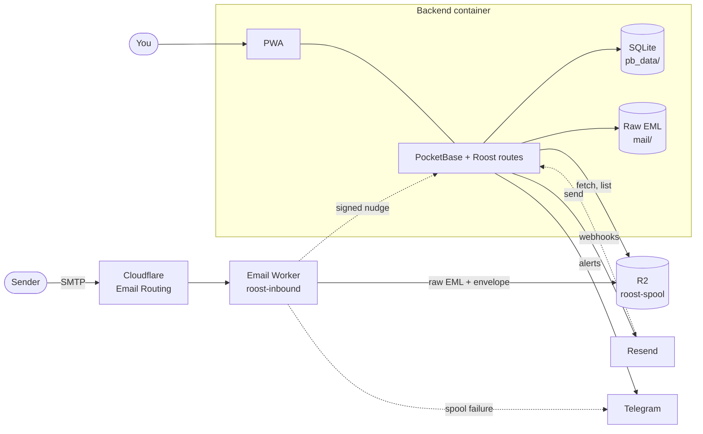

# Architecture

Roost receives mail through Cloudflare, stores and indexes it on a backend you run, and sends through Resend. One user, any number of catch-all domains. The reasons behind these choices are in [decisions.md](decisions.md).

Solid lines are the main path; dotted ones are best effort.

## Components

| Part | Where | Does |
| --- | --- | --- |
| Worker | `worker/`, Cloudflare | Writes each message to R2, then nudges the backend. Nothing else. |
| Spool | R2 bucket `roost-spool` | Durable buffer between Cloudflare and the backend; a lifecycle rule expires it. |
| Backend | `server/`, one Docker image | PocketBase as a Go framework: ingest, threading, search, send, alerts, API. |
| PWA | `web/`, served by the backend | SvelteKit SPA: read, search, compose, settings. |
| Data volume | `/data` | `pb_data/` (SQLite: indexed data only) and `mail/` (raw EML, written once). |

## Receiving

1. Email Routing hands the message to the Worker, which writes the raw bytes to R2 at `YYYY/MM/DD/HHMMSS-<uuid>.eml` with the envelope `from` and `to` as object metadata (catch-all and Bcc recipients are not reliably in the headers). The write is retried twice. If it still fails, the Worker alerts Telegram and throws, so the message is not accepted silently.
2. The Worker then sends a nudge: `POST /api/roost/nudge` with the key, signed with HMAC-SHA256 over `<timestamp>.<body>` using the shared nudge secret. The backend rejects timestamps more than 5 minutes off. Nudge failures are ignored.
3. The backend's `ingest(key)` fetches the object, parses it (enmime), writes the raw file to `mail/<key>`, and stores the message, attachment index, contacts and thread in one transaction.
4. A sweep every 5 minutes lists R2 from the newest ingested key (minus a margin) and ingests any key the database has not seen, so a lost nudge only delays mail.

Ingest is idempotent. A key already stored is skipped, and the same Message-ID delivered to two addresses becomes one message with both recipients. Failures are recorded in `ingested_keys` and retried by the sweep, up to 5 attempts; oversize mail fails at once.

## Storage

- **SQLite** holds only what the app queries: messages (headers, text body, flags), threads, attachment metadata, contacts, domains, identities, labels, the send log and ingest bookkeeping. An FTS5 trigram table backs search. Every mail list is a search: the sidebar's folders and mailboxes are query terms, and the PWA parses the search box with `@gera2ld/filter-query` and sends the tree to `/api/roost/search`, which binds the field names (`store/query.go`) and returns a page of matching threads, newest first. Drafts have their own list.
- **Raw EML** files never change. Attachments and forwarded content are re-extracted from them on demand, and `roost reparse` rebuilds rows after a parser change.
- **Schema** is `server/internal/store/schema.json`, applied in full on every start. There are no migrations.

## Threading

Messages join threads by header links first (In-Reply-To, References, including a parent that arrives late), and by normalized subject only as a guarded fallback. Archive and trash act on whole threads; new mail revives a thread.

## Sending

Drafts are `messages` rows with `direction = outbound`. Sending:

1. checks the From domain has sending turned on (Settings) and the recipients are valid;
2. builds the raw EML copy (Bcc kept only in the database) and stores it like received mail;
3. calls Resend with an idempotency key of record ID + Message-ID, so a retry never sends twice;
4. threads the sent message with the conversation.

Resend webhooks (sent, delivered, bounced, complained) are verified Svix-style and logged in `send_log`. Resend delivers through Amazon SES, which replaces the Message-ID Roost sets; the `email.sent` webhook reports the delivered one, and Roost switches the message to it and re-threads, so replies to it join the conversation. Identities add a display name and a `-- ` signature block to new drafts.

## Alerts and monitoring

Telegram alerts are best effort and never block ingest:

- **New mail:** queued after ingest commits; bursts batch into one summary.
- **Pipeline health** (every 30 minutes): the sweep cannot list R2, spooled mail older than 2 hours is not stored (it is ingested on the spot when possible), or no mail has arrived for a set number of days. Each problem alerts once, repeats daily, and sends an all-clear.
- **Delivery:** a bounce or spam complaint on sent mail alerts at once.
- **Worker:** a message that cannot be written to R2 alerts directly from the Worker.

A daily job purges threads trashed over 30 days ago and trims ingest bookkeeping for keys past the R2 lifecycle window.

## Security model

- **Inbound mail is untrusted.** The PWA renders text only: no email HTML, no remote images. Attachment names are sanitized and always served as downloads.
- **Reads and writes:** the PWA reads through PocketBase's record API, which only the signed-in user can access. Every write goes through `/api/roost/*` routes, and collections reject direct writes. There is no signup; the CLI creates the one user, and OAuth2 sign-ins only link to that user by email.
- **Server-to-server:** the nudge is HMAC-signed and replay-limited; a replay only re-runs an idempotent ingest. Resend webhooks are signature-checked.
- **Secrets** (R2, Resend, Telegram, nudge) live in the backend's environment and the Worker's secrets, never in the PWA or the repo.

## Code map

| Package                     | Role                                                            |
| --------------------------- | --------------------------------------------------------------- |
| `server/internal/spool`     | Key format and the R2 client (shared contract with the Worker). |
| `server/internal/ingest`    | Ingest, sweep, nudge route, import, trim and purge.             |
| `server/internal/mailparse` | MIME parsing, charset handling, attachment extraction.          |
| `server/internal/threading` | Thread assignment and derived thread counts.                    |
| `server/internal/store`     | Schema snapshot, sync on start, full-text search.               |
| `server/internal/api`       | The `/api/roost/*` routes.                                      |
| `server/internal/outbound`  | Drafts, identities, sending, Resend client and webhooks.        |
| `server/internal/notify`    | Telegram client and alert batching.                             |
| `server/internal/monitor`   | Pipeline health checks.                                         |
